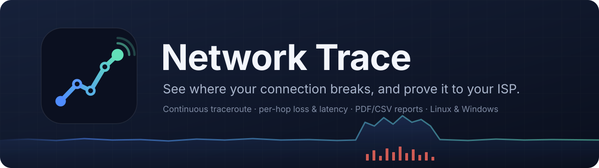

<p align="center">
  
</p>

<p align="center">
  <a href="https://github.com/jkop-xyz/network-trace/releases"><b>Download</b></a> ·
  <a href="#using-it">Using it</a> ·
  <a href="#development">Development</a>
</p>

> [!NOTE]
> This project was written by an AI (Claude, via Claude Code), working from a design worked out together with a human. Expect rough edges, and check the results before relying on them.

A desktop app for Linux and Windows that keeps tracing the route to a host, recording latency and packet loss at every hop over time. When something goes wrong, you can export the evidence as a Report (HTML or PDF) and a CSV to send to your ISP.

See [GLOSSARY.md](GLOSSARY.md) for the terms used throughout (Session, Target, Hop, Sample, Gap, Time Window…).

## Using it

- Type a hostname or IP address and press **Start**. Each Target gets its own Session, and several can run at once.
- The hop table shows loss, latency and jitter per Hop for the chosen **Time Window**. Loss that carries through to the Target is red; loss that doesn't (usually a router rate-limiting its replies) is amber. Click a Hop number to graph it.
- Right-click any IP address to copy it or look up who owns it (public RDAP registry, only when you ask).
- **Overview** shows several Sessions side by side in a 1×1 to 3×3 grid. Its Time Window applies to all Sessions (a single Session can also "Apply to all Sessions"), and **Export combined Report** makes one Report covering the Sessions you pick.
- **Export Report (PDF) / HTML** makes a Report for the current Time Window. It opens with a plain-language summary of where loss starts. For PDF, pick "Save as PDF" (Windows) or "Print to File" (Linux) in the print dialog.
- **Export CSV** writes one row per Probe: `timestamp,hop,address,rtt_ms,lost`.
- Closing the window keeps Sessions running in the tray. Use **Quit** in the tray menu to stop them. Starting the app again brings the running copy to the front.
- Stopped Sessions can be deleted from their page or in bulk from **Storage**.
- Targets given on the command line start straight away: `network-trace 1.1.1.1 192.168.1.1`.

No admin rights are needed. On Linux this relies on unprivileged ICMP, which most distros allow. If yours doesn't, the app tells you, and this fixes it:

```sh
sudo sysctl -w net.ipv4.ping_group_range="0 2147483647"
```

Downloads are unsigned, so Windows SmartScreen warns the first time you run the `.exe`.

## Development

Needs Rust (stable), Node 22+ and, on Linux, the [Tauri prerequisites](https://v2.tauri.app/start/prerequisites/) (WebKitGTK 4.1, libayatana-appindicator).

```sh
npm install
npm run tauri dev                  # run the app
cargo test -p trace-core           # core tests (probing, storage, stats)
npm run check                      # type-check the UI
cargo run -p trace-core --example synth -- <sessions dir>   # synthetic Session with loss, a Gap and a Route Change
```

Layout:

- `crates/trace-core`: probing (Linux ping sockets, Windows `IcmpSendEcho2`), the Session engine, SQLite storage (one file per Session), stats and CSV export. No UI code.
- `src-tauri`: the desktop shell: commands, tray and printing.
- `src`: the Svelte UI. `src/lib/chart.ts` draws graphs for both the screen and Reports, and `src/lib/report.ts` builds Reports from a list of sections.

Pushing a `v*` tag builds the Linux AppImage and the Windows portable `.exe` and attaches them to a GitHub Release (a pre-release for tags like `v0.1.0-beta.1`).
